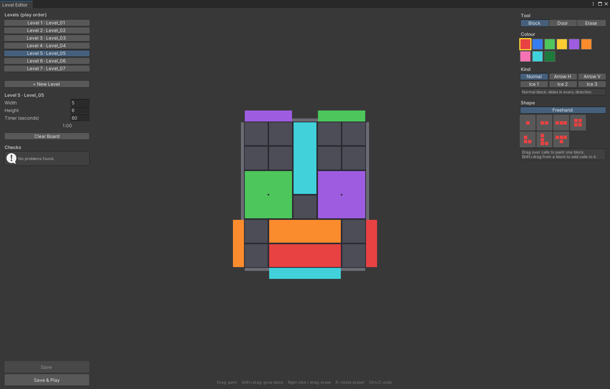

# Color Block Jam — vertical slice

A vertical slice of Rollic's *Color Block Jam*: home screen, settings, seven levels with a countdown, persistent
coins, pause / restart / fail flow, and an in-editor level editor a designer can use without touching code or files.

Unity **2022.3.62f2**, URP (mobile "Performant" asset), portrait 1080×1920 (also laid out for 20:9), Android.
No third-party packages; only the supplied art.

## Open and run

1. Open the folder in Unity Hub with Unity **2022.3.62f2** (Android Build Support for the APK).
2. Open `Assets/_Project/Scenes/Boot.unity`, the only scene; screens and popups are children of its canvas.
3. Set the Game view to **1080x1920** (or 1080x2400 for 20:9) and press Play.
4. Drag a block with the mouse (one finger on device). A block leaves through a door of its colour that is wide
   enough for it. Clear the board before the timer runs out.

Build: **Tools > Build > Android** writes `Builds/Android/ColorBlockJam.apk` (IL2CPP, ARM64).
Tests: **Window > General > Test Runner > EditMode > Run All**.

## Make a level in the editor



1. **Tools > Color Block Jam > Level Editor**, then **+ New Level** (or pick a level under *Levels (play order)*).
2. Set **Width**, **Height** and **Timer (seconds)**.
3. **Block** tool: pick a colour and drag over cells — one drag is one block; *Shift+drag* grows a block. *Shape*
   presets stamp with a click (**R** rotates). *Kind* picks Normal, Arrow H/V or Ice 1–3.
4. **Door** tool: pick a colour and click or drag over the slots around the board.
5. Right-click or *Erase* removes; **Ctrl+Z** undoes.
6. **Checks** lists errors (block saving) and warnings (ask for confirmation).
7. **Save**, then **Save & Play**. Playing from the editor never touches saved progress or coins.

The editor writes `Assets/_Project/Levels/Level_NN.asset` and appends it to `LevelCatalog.asset`; the game reads
the same `LevelData`. Every shipped level was made in this editor.

## Architecture

```
Core      pure C#: Board (BoardModel, Block, Door, MoveResolver), Level (LevelData, LevelValidator)
Data      ScriptableObjects: LevelDefinition, LevelCatalog, GameConfig, BlockPalette, BoardSkin
Gameplay  Board views, Input (DragInput, BlockDrag), Camera (CameraFit), Session (LevelSession, LevelPlayer)
UI        UIRouter, ScreenFlow, Screens, Widgets
App       GameBootstrap (composition root), LevelOrder, Save (SaveService over IKeyValueStore)
Editor    LevelEditor window, BuildScript
```

Each folder is an assembly; references only point left (Core ← Data ← Gameplay ← UI ← App, Editor sees
Core + Data + Gameplay) and an EditMode test fails if an asmdef breaks that.

- **Pure C# model, thin views.** Board rules live in `CBJ.Core` with no Unity scene dependency, so they are tested
  in EditMode. Views subscribe to model events and never poll.
- **Cell model under a continuous drag.** The model moves whole cells with a collision check per step; the held
  block follows the finger freely and the model steps whenever its rounded position changes.
- **One level format.** `LevelData` (plain serializable class) inside a `LevelDefinition` ScriptableObject,
  ordered by `LevelCatalog`: Unity-native, inspectable, no file handling. Blocks are stored as cell lists, so any
  shape can be drawn without code.
- **IMGUI `EditorWindow` editor.** Paint, settings, checks, Save and Play in one window; cheaper than a runtime
  editor for no loss here.
- **uGUI with a small `UIRouter`.** The supplied UI is 9-sliced sprites; Canvas Scaler 1080×1920, match 0.5, and a
  safe-area fitter hold 16:9 to 20:9.
- **No packages, manual composition root.** `GameBootstrap` wires every system in one place; test doubles go
  through interfaces (`IPointerSource`, `IKeyValueStore`).
- **Data-driven, allocation-free.** Tuning lives in `GameConfig`, `BlockPalette`, `BoardSkin`. One shared material
  per piece type, colour via `MaterialPropertyBlock`; each block is one pooled merged mesh.

Performance: on a 7×9 stress level in the editor, merging block pieces cut board renderers from 313 to 146 and
draw calls from 206 to 39 while dragging. Script GC allocation per frame while dragging is 0 B.

## Optional scope

Added after the required scope was complete, with rules in Core and EditMode tests: **O1** static level validation
in the editor; **O3** ice blocks (frozen until that many other blocks have left); **O4** arrow blocks (move and
exit along one axis); **O2** partly — *Hammer* destroys a tapped block and *Freeze* stops the timer for 10 s, one
use each per attempt. *Vacuum* and *Rocket* stay placeholders: no rules were given for them.

## Decisions

- **Doors** are painted per cell; touching cells of one colour on one edge form one door strip.
- **Exit rule:** a block leaves through a door of its colour only if its side fits the door's width and every cell
  has a clear path to that edge.
- **Free drag over the cell model:** the block slides along walls and blocks instead of snapping per cell; the
  rules stay discrete and testable.
- **Auto-exit after settle:** a released block whose cell touches its door eases onto the cell and slides out, so
  the player never has to line it up exactly.
- **Validation is static:** sizes, overlaps, out-of-range cells and a wide-enough door per block; no solver.
- **Block kinds and boosters:** ice and arrow blocks, Hammer and Freeze were chosen as the most self-contained of
  the optional features.
- **No audio or haptics:** none was supplied; the settings toggles save their on/off state only.
- **After the last level** the game wraps to level 1.

## Known problems

- Device-tested on one Android phone (mine) only.
- Fast swipes occasionally miss a grab on device — a 0.35-cell tolerance was added, root cause not confirmed.
- No Android back-button handling.
- Reordering the catalog moves a player's saved index to a different level.
- Reserved UI bands are tuned for 16:9 to 20:9, not for tablets.
- A level made invalid by hand is not guarded at runtime; the editor is the only checked path.
- In the game an ice block does not show its remaining layers (the editor does).

## LLM tools

Claude Code (Anthropic) was used as an implementation assistant: writing C# from my architecture spec and
decision records, EditMode tests, editor-tool boilerplate (IMGUI), and the first draft of this README.
Architecture and data-model decisions, the editor's UX design, level design, code review, device testing and
the final verification of every acceptance criterion are my own work. No LLM-generated art or assets were used.

## Approximate work time

About 12 hours over three days (24–26 October 2026): planning and decision records, then the milestones from setup
to this build.
